<p align="center"></p>

<p align="center"><b>RTO Shield scores every Indian D2C order for return-to-origin (RTO) risk before dispatch, explains the score, and picks a cost-aware action.</b></p>

<p align="center">
  
  
  
  
  
  
</p>

---

## The problem

When a cash-on-delivery (COD) parcel is refused or undeliverable, the seller pays forward shipping, return shipping and packaging, and the stock is locked until it comes back. There is no official national RTO rate and vendors define it differently, so treat these as directional published figures (compiled in [`research/india-data/INDEX.md`](research/india-data/INDEX.md)):

- ClickPost, FY2026, D2C brands with 1,000+ COD orders: COD RTO **37.51%** vs prepaid **5.28%**.
- Meesho prospectus (RHP), failed/undelivered orders, FY25: COD **22.30%** vs prepaid **2.72%** (read via a ClickPost summary, not the RHP itself).
- ClickPost, COD-heavy brands, FY2026: Tier-3 pincodes **23.73%** vs metros **10.92%**.
- Delhivery (2024 statement, via Inc42 and Business Standard): industry-average RTO about **14-18%**.
- Loaded cost per RTO is about Rs 350 (range 285-490) at a Rs 1,200 average order value, per the same index. Its original source is not named there.

RTO Shield targets a 15-25% relative RTO reduction. Every savings figure in the app is an estimate and has to be validated in a real pilot.

## Preview

<p align="center"></p>
<p align="center"></p>

<table>
  <tr>
    <td width="50%">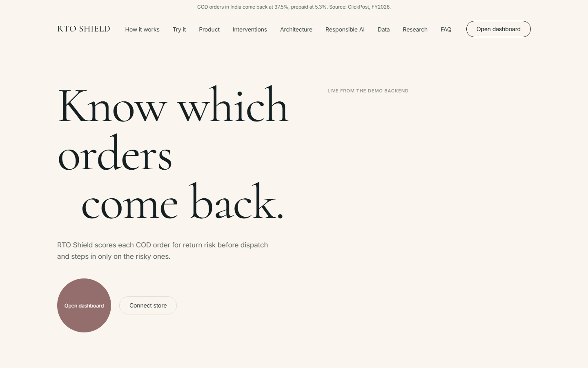<br><sub>Landing</sub></td>
    <td width="50%">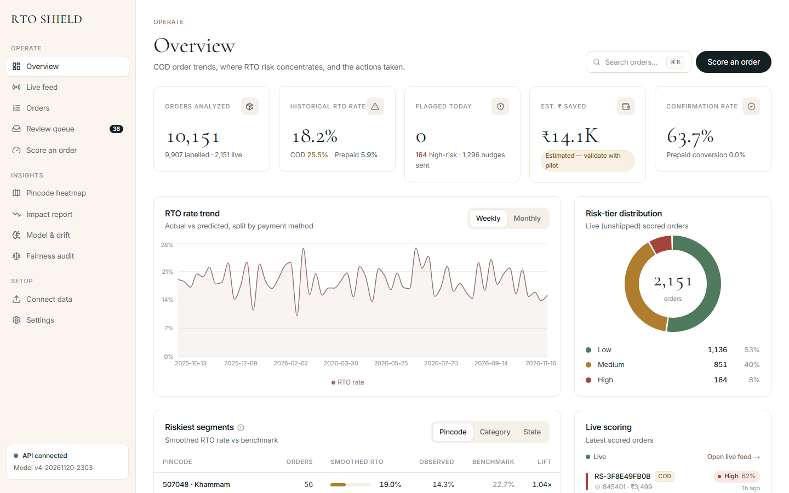<br><sub>Dashboard</sub></td>
  </tr>
  <tr>
    <td>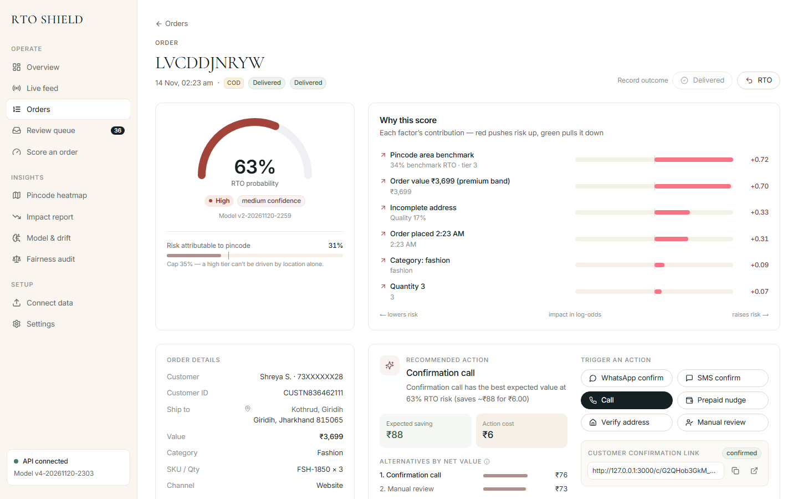<br><sub>Order detail with reasons and timeline</sub></td>
    <td>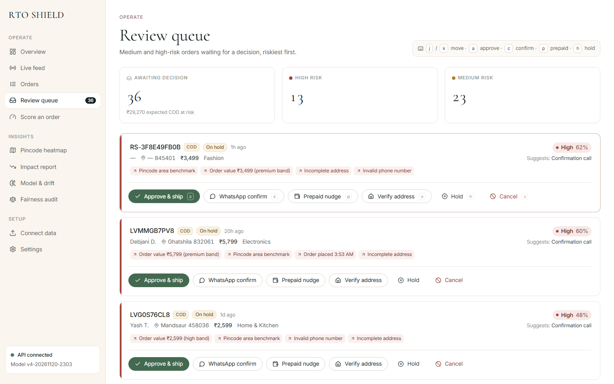<br><sub>Seller decision queue</sub></td>
  </tr>
  <tr>
    <td>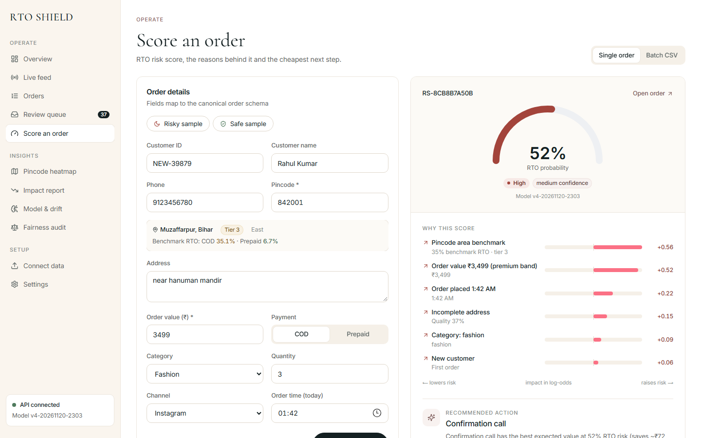<br><sub>Score and what-if</sub></td>
    <td>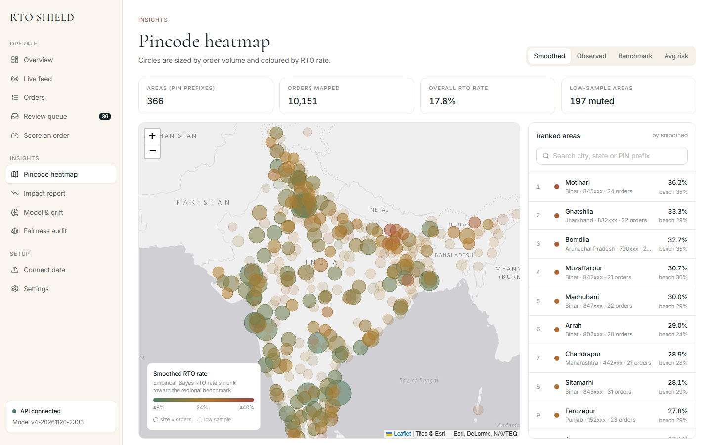<br><sub>Pincode-prefix heatmap</sub></td>
  </tr>
  <tr>
    <td>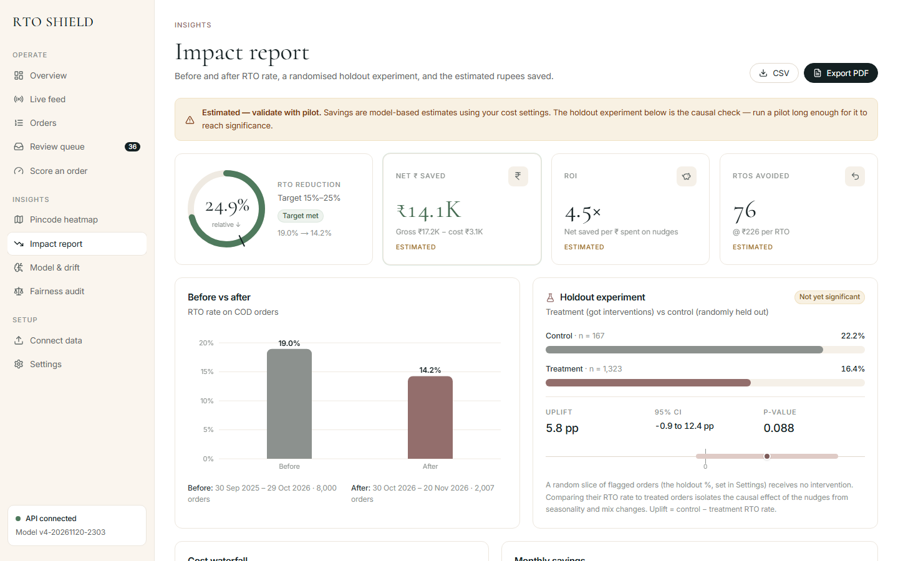<br><sub>Impact report</sub></td>
    <td>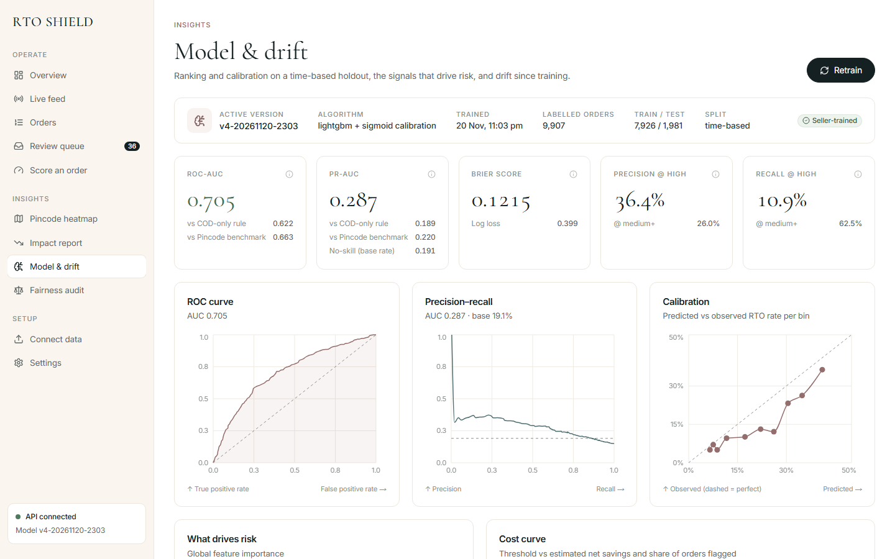<br><sub>Model, calibration and drift</sub></td>
  </tr>
  <tr>
    <td>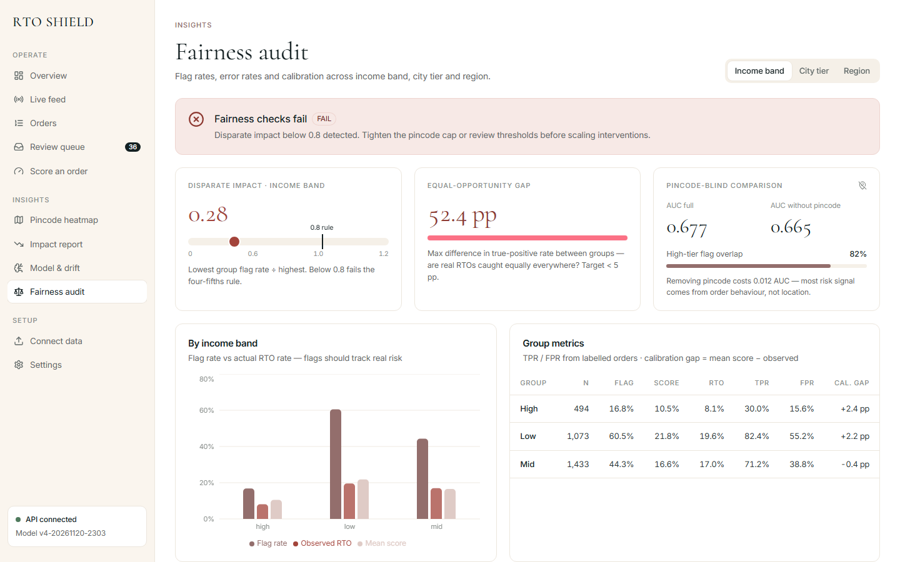<br><sub>Fairness audit</sub></td>
    <td>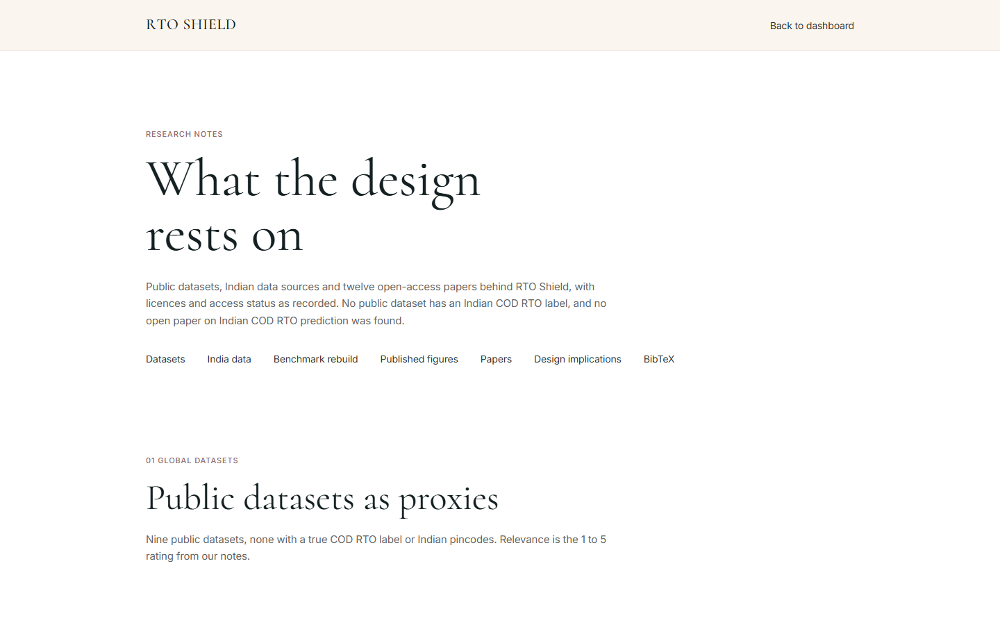<br><sub>Research page</sub></td>
  </tr>
  <tr>
    <td colspan="2">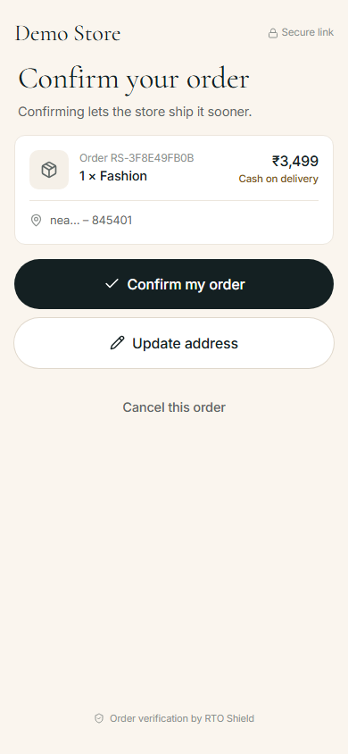<br><sub>Customer confirmation page (<code>/c/{token}</code>)</sub></td>
  </tr>
</table>

## Features

| Feature | What it does | Where |
|---|---|---|
| CSV ingestion | Detects Shopify, WooCommerce, Shiprocket or canonical exports; fuzzy header mapping; data-quality report | `backend/app/integrations/csv_mapper.py`, `backend/app/api/ingest.py` |
| Shopify / WooCommerce sync | Pulls orders from the store API; normalises webhook payloads | `backend/app/integrations/shopify.py`, `woocommerce.py` |
| Real-time webhooks | HMAC-verified order-created webhooks are scored on arrival | `backend/app/api/webhooks.py` |
| Risk model | LightGBM (sklearn fallback) with sigmoid calibration, time-based split, leakage-safe customer and pincode history | `backend/app/ml/trainer.py`, `features.py` |
| Real-time scoring | `POST /api/score` returns probability, tier, confidence, reasons and a recommendation | `backend/app/services/scoring.py`, `backend/app/api/score.py` |
| Configurable actions | WhatsApp, SMS, confirmation call, prepaid nudge, address verification, manual review; providers: mock, Twilio, Meta WhatsApp, MSG91 | `backend/app/services/actions.py`, `backend/app/integrations/messaging.py` |
| Dashboard | KPIs, trends, top-risk pincodes, categories, states, cities, with minimum-sample safeguards and smoothing | `backend/app/services/analytics.py`, `frontend/src/app/(app)/dashboard` |
| Heatmap | Pincode-prefix map of observed and smoothed RTO rates | `frontend/src/app/(app)/heatmap`, `frontend/src/components/insights/heatmap-map.tsx` |
| Suggested action | Per-order recommendation with expected saving, cost and alternatives | `backend/app/services/policy.py`, `frontend/src/components/app/recommendation-card.tsx` |
| Before/after impact report | Baseline vs pilot period, plus treatment vs holdout control, cost, net savings and ROI; CSV export | `backend/app/services/impact.py`, `frontend/src/app/(app)/impact` |
| Cold start | Seller with no history gets a transparent benchmark model, blended into the trained model as labelled orders grow | `backend/app/ml/scorer.py`, `backend/app/data/benchmarks.py` |
| Model drift | PSI per feature, retrain recommendation, scheduled or drift-triggered retraining | `backend/app/ml/drift.py`, `backend/app/services/scheduler.py` |
| Bias and fairness | Audit by income band, pincode tier and region; pincode-blind comparison; fairness guard on the tier | `backend/app/ml/fairness.py`, `frontend/src/app/(app)/fairness` |
| What-if | Change payment method, value and so on, and see the score move | `frontend/src/components/app/what-if.tsx`, `POST /api/score/what-if` |
| Holdout A/B | Deterministic hash holdout; two-proportion z-test, p-value and 95% CI | `backend/app/services/policy.py`, `impact.py` |
| Explanations | Top six signed reasons per score with plain labels | `frontend/src/components/app/reason-bars.tsx`, `backend/app/ml/scorer.py` |
| Simulator and live feed | Synthetic live orders with stochastic outcomes; SSE stream to the UI | `backend/app/services/simulator.py`, `frontend/src/components/app/live-feed.tsx` |
| Hindi templates | `render_template(..., lang="hi")` for confirm, prepaid nudge and address verify | `backend/app/integrations/messaging.py` |
| Command palette | Keyboard navigation (cmdk) | `frontend/src/components/app/command-palette.tsx` |
| Customer confirm page | Customer confirms, cancels, converts to prepaid or updates the address; token expires after 48 h | `frontend/src/app/c/[token]`, `backend/app/api/public.py` |
| Seller queue | Approve, hold, cancel, send confirmation, send prepaid nudge or verify address | `backend/app/api/orders.py`, `frontend/src/app/(app)/queue` |

## Architecture

<p align="center">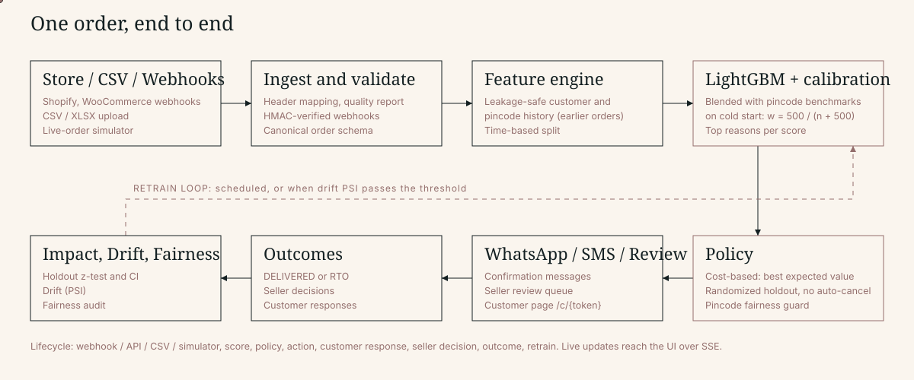</p>

The FastAPI backend (`:8000`) owns ingestion, the model, the policy and the monitors. The Next.js frontend (`:3000`) talks to it over REST and an SSE stream (`/api/stream/events`). Storage is SQLite by default, or Postgres through `RTO_DATABASE_URL`. The dashed line is the retrain loop: the scheduler retrains every `retrain.schedule_days`, or earlier when drift PSI passes the configured threshold.

<details>
<summary>Backend layers (from the code)</summary>

| Layer | Contents |
|---|---|
| `api/` | ingest, webhooks, score, orders (incl. queue), public, dashboard (incl. impact), model, system (health, settings, simulate, stream, benchmarks) |
| `services/` | scoring, model_registry, policy, actions, analytics, impact, monitoring, training, simulator, scheduler, seed |
| `ml/` | features, trainer, scorer, fairness, drift, seasonality |
| `data/` | pincode benchmark table, synthetic order generator |
| `integrations/` | csv_mapper, shopify, woocommerce, messaging |
| `db/` | SQLAlchemy 2.0 models |

</details>

## Scoring pipeline

<p align="center"></p>

The order in the animation is a made-up example. Features go into the calibrated model, the probability maps to a tier through two thresholds (defaults 0.18 and 0.35, editable in Settings), and the policy picks an action. A hash-based share of flagged orders (`holdout_pct`, default 10%) is withheld as a control group so the effect can be measured.

## Risk-tiered actions

<p align="center"></p>

The default policy (`cost_optimal`) evaluates every candidate action and takes the best expected value. `loss` is the cost of one RTO.

```
loss   = forward_shipping + return_shipping + packaging + turnover_cost_pct * order_value
net(a) = p * eff_a * loss  -  cost_a  -  (1 - p) * friction_a * margin_pct * order_value
action = argmax over a of net(a)          # NONE has net 0
```

Effectiveness priors in `policy.py`: WhatsApp confirm 0.35, SMS confirm 0.30, call 0.45, prepaid nudge 0.55 x 0.30 acceptance, address verify 0.25, manual review 0.50. Address verification is discounted by 0.4 when the order has no address-related risk reason. An action is skipped when the pincode fairness guard has capped the tier, unless it is a soft action (confirmation message or address verification). Low-tier orders get no action unless net value is at least 1. The alternative `tier_rules` policy maps tier to action from Settings. Nothing is ever cancelled automatically.

## Cold start

<p align="center"></p>

A new seller has no labelled orders, so `RiskScorer.cold_start()` scores from the pincode benchmark table (at least 150 three-digit prefixes, per `CONTRACT.md`). Once a trained model exists, the final probability is `w * model + (1 - w) * benchmark` with `w = n / (n + 500)`, where `n` is the seller's labelled orders. The benchmark weight is therefore `500 / (n + 500)`: 0.5 at 500 orders and 0.2 at 2,000.

## Model and results

All numbers below were read from the running API (`/api/model/active`, `/api/dashboard/summary`, `/api/impact/report`, `/api/model/fairness`) **on the bundled synthetic demo data**: 10,151 orders, 9,907 labelled, model `v4-20261120-2303` (LightGBM + sigmoid calibration, time-based split, 7,926 train / 1,981 test, test period 28 Oct to 18 Nov 2026).

| Model (held-out time slice) | ROC-AUC | PR-AUC |
|---|---|---|
| RTO Shield (LightGBM, calibrated) | **0.705** | **0.287** |
| Pincode benchmark only | 0.663 | 0.220 |
| COD flag only | 0.622 | 0.189 |

Test-set base RTO rate is 19.1%, so PR-AUC 0.287 is the figure to compare with 0.191. Brier 0.121, log loss 0.399. At the suggested thresholds (medium 0.259, high 0.41): the high tier has precision 0.364 and recall 0.109; the medium-or-above flag has precision 0.260 and recall 0.625.

| Impact report (pilot vs holdout) | Value |
|---|---|
| Baseline RTO rate (8,000 orders) | 18.96% |
| Pilot-period RTO rate (2,007 orders) | 14.25% (24.85% relative reduction, before/after, can be confounded by season and mix) |
| Treatment vs holdout control | 16.40% (n=1,323) vs 22.16% (n=167) |
| Uplift, 95% CI, p-value | 5.75 points, [-0.85, 12.36], p = 0.088, **not significant** |
| Estimated net saving / ROI | Rs 14,081 / 4.49x, labelled "Estimated: validate with pilot" |

Honest reading:

- The data is synthetic. It has a built-in causal structure (COD, tier-3, late-night, festival, monsoon), so these metrics show the pipeline works and say nothing about real Indian sellers.
- The holdout is small (167 resolved control orders). The interval includes zero, so the report does not claim a proven effect. The 24.85% before/after figure is not causal.
- Customer responses and treatment effects in the simulator are assumptions, not measured behaviour.
- The fairness audit returns status **fail** on this data: flag rate is 60% for the low income band vs 17% for high (ratio 0.28), and 60% for Tier 3 vs 12% for Tier 1 (ratio 0.19). Observed RTO also differs between those groups (20% vs 8%, 20% vs 7%), so part of the gap follows the generated data, but equal-opportunity gaps of 52% (income) and 60% (tier) mean RTO-bound orders are caught unevenly. The pincode-blind model has ROC-AUC 0.665 vs 0.677 with pincode, and 82% flag overlap. The app reports this as it is and does not hide it.

## Responsible AI

- **No protected attributes in the model.** `income_band` is used only by the fairness audit.
- **Pincode fairness guard.** If most of an order's risk comes from its pincode (`pincode_share > pincode_cap`, default 0.35) and that alone would make it high, the tier is capped at medium, `fairness_adjusted` is set, and only soft actions apply.
- **Human in the loop.** No automatic cancellation. Cancelling is a customer choice or a seller decision in the queue.
- **Explainable.** Each score lists its top reasons and a confidence level; cold-start scores are labelled.
- **Measured.** A randomized holdout, smoothed benchmarks, and small-sample segments flagged instead of ranked.
- **Privacy.** Phone numbers are masked in API responses; customer links use random tokens that expire after 48 hours.

## Data and research

Everything is in [`research/`](research) and summarised on the in-app `/research` page (`frontend/src/app/research`). No public dataset has a true Indian COD RTO label with pincodes, so all public sets here are proxies and the India benchmarks are priors, not ground truth.

<details>
<summary>Global datasets (proxies)</summary>

| # | Dataset | Status | Licence (per index) | Use |
|---|---|---|---|---|
| 01 | Olist | downloaded, 127 MB | CC BY-NC-SA | Primary proxy: cancellations, boleto payment, zip prefix |
| 02 | DataCo | downloaded, 96 MB | CC BY 4.0 | `Type=CASH` flag, cancel/fraud status; semi-synthetic, leaky late label |
| 03 | UCI Online Retail | downloaded | CC BY 4.0 | Cancellations and repeat-customer history |
| 04 | UCI Online Retail II | downloaded | CC BY 4.0 | Larger version of 03 |
| 05 | LaDe | sample only (Jilin, 4.7 MB) | Apache-2.0 | Courier and geo delivery time |
| 06 | Amazon Last Mile | partial, 454 MB | CC BY-NC | Only set with per-package delivery-attempted / rejected |
| 07 | Kaggle E-Commerce Shipping | login required | not stated | Toy on-time dataset |
| 08 | Turkish Product Returns | downloaded, 3 MB | not stated | Return review text, no order labels |
| 09 | Amazon Delivery India | login required | not stated | India, delivery time only |
| 10 | ASOS GraphReturns | link unverified | not stated | Fashion returns at scale |

</details>

<details>
<summary>India datasets</summary>

| # | Source | Licence | Status | Use |
|---|---|---|---|---|
| 01 | India Post pincode directory (data.gov.in) | GODL-India | downloaded, about 19.3k pincodes | pincode to district, state, lat/lng |
| 02 | DoE HRA city list; Census 2011 district mirror | government order; CC-BY-4.0 mirror | partial | city tier, literacy |
| 03 | NFHS-5 district factsheets; RBI NSDP; SHRUG/VIIRS | CC-BY-4.0 mirror / GODL / RBI | partial (RBI blocked by CAPTCHA, SHRUG needs registration) | fairness-audit income bands |
| 04 | ClickPost, Base, Razorpay, Unicommerce pages; Shadowfax 3PL PDF | publishers' copyright | saved pages plus one PDF | benchmark priors |
| 05 | IMD monsoon 2026, sale dates, festival CSV | public / press | partial, festival dates need verification | seasonality, drift |

</details>

<details>
<summary>12 papers</summary>

Papers 03, 04, 05, 08, 11 and 12 were summarised from the abstract and first page only. For the others (marked "fuller") the index does not state how much was read. Each folder in [`research/papers`](research/papers) holds `paper.pdf` and `summary.md`; no open paper specifically on Indian COD RTO prediction was found.

| # | Title | Authors | Year | Link | Depth |
|---|---|---|---|---|---|
| 01 | Early Bird Catches the Worm: Predicting Returns Even Before Purchase in Fashion E-commerce | Kedia, Madan, Borar | 2019 | [arXiv 1906.12128](https://arxiv.org/abs/1906.12128) | fuller |
| 02 | A Dataset for Learning Graph Representations to Predict Customer Returns in Fashion Retail | McGowan et al. | 2023 | [arXiv 2302.14096](https://arxiv.org/abs/2302.14096) | fuller |
| 03 | Parcel loss prediction in last-mile delivery: deep and non-deep approaches with insights from Explainable AI | de Leeuw, Bukhsh, Zhang | 2023 | [arXiv 2310.16602](https://arxiv.org/abs/2310.16602) | abstract / first page |
| 04 | Data models for service failure prediction in supply-chain networks | Sharma et al. | 2018 | [arXiv 1810.09944](https://arxiv.org/abs/1810.09944) | abstract / first page |
| 05 | Learning Reasons for Product Returns on E-Commerce | Farber, Novgorodov, Guy | 2024 | [ACL Anthology](https://aclanthology.org/2024.ecnlp-1.1) | abstract / first page |
| 06 | Predicting Good Probabilities With Supervised Learning | Niculescu-Mizil, Caruana | 2005 | [PDF](https://www.cs.cornell.edu/~alexn/papers/calibration.icml05.crc.rev3.pdf) | fuller |
| 07 | On Calibration of Modern Neural Networks | Guo et al. | 2017 | [arXiv 1706.04599](https://arxiv.org/abs/1706.04599) | fuller |
| 08 | Causal Inference and Uplift Modeling: A Review of the Literature | Gutierrez, Gerardy | 2017 | [PMLR v67](https://proceedings.mlr.press/v67/gutierrez17a.html) | abstract / first page |
| 09 | Failing Loudly: An Empirical Study of Methods for Detecting Dataset Shift | Rabanser, Gunnemann, Lipton | 2019 | [arXiv 1810.11953](https://arxiv.org/abs/1810.11953) | fuller |
| 10 | Equality of Opportunity in Supervised Learning | Hardt, Price, Srebro | 2016 | [arXiv 1610.02413](https://arxiv.org/abs/1610.02413) | fuller |
| 11 | The Measure and Mismeasure of Fairness | Corbett-Davies et al. | 2023 | [arXiv 1808.00023](https://arxiv.org/abs/1808.00023) | abstract / first page |
| 12 | Instance-Dependent Cost-Sensitive Learning for Detecting Transfer Fraud | Hoppner et al. | 2020 | [arXiv 2005.02488](https://arxiv.org/abs/2005.02488) | abstract / first page |

</details>

<details>
<summary>More published RTO figures, and gaps</summary>

- City tier, all payment modes (ClickPost, 35.8M orders, Oct-Nov 2025): Metro 6.60%, Tier 1 8.10%, Tier 2 11.50%, Tier 3+ 12.00%.
- Seasonality: D2C RTO about 39% in Nov 2025 vs about 21% in Feb 2026 (Unicommerce / Shipway via Business Standard).
- RTO causes, share of RTOs (ClickPost): COD refusal 28-38%, address failure 18-26%, buyer unreachable 14-20%, fake orders 6-12%.
- Orders with 1 / 2 / 3+ failed delivery attempts end as RTO 20.2% / 45.5% / 88.5%.
- Category COD RTO bands (ClickPost FY2026): fashion 21-32%, health 18-29%, beauty 18-27%, home 16-25%.

Gaps stated in the index: no official national RTO rate; no state-level RTO rates; no pincode-level public RTO data; some vendor figures (Base.com, Razorpay) have no stated methodology or are unsourced; festival dates still need verification; the Meesho RHP and Delhivery DRHP were not downloaded.

</details>

## Tech stack

| Layer | Stack |
|---|---|
| Backend | Python 3.13, FastAPI, SQLAlchemy 2.0, pydantic-settings, APScheduler, sse-starlette, httpx |
| ML | LightGBM, scikit-learn, pandas, numpy, scipy, joblib |
| Storage | SQLite by default; Postgres via `psycopg` |
| Frontend | Next.js 15 (App Router), React 19, TypeScript, Tailwind CSS 3, TanStack Query, Recharts, Leaflet / react-leaflet, framer-motion, GSAP, Lenis, cmdk, sonner |

## Project structure

```
rto-shield/
  CONTRACT.md            interface contract between backend modules and UI
  start.ps1, start.sh    start both dev servers
  backend/
    run.py               uvicorn entry point
    requirements.txt
    app/
      main.py
      api/               REST routers
      core/              config, events (pub/sub), logging
      data/              pincode benchmarks, synthetic generator
      db/                SQLAlchemy models and session
      integrations/      csv_mapper, shopify, woocommerce, messaging
      ml/                features, trainer, scorer, fairness, drift, seasonality
      schemas/           API schemas
      services/          scoring, policy, actions, impact, analytics, scheduler, simulator, seed
    sample_data/         canonical, Shopify and WooCommerce sample CSVs
    tests/               test_api.py, test_data.py, test_ml.py
  frontend/
    DESIGN.md            design brief and tokens
    src/app/             landing, (app)/ pages, c/[token], research
    src/components/      app, insights, landing, shell, ui
    src/lib/
  research/              datasets/, india-data/, papers/ (each with INDEX.md)
  docs/media/            README banner, diagrams, screenshots
```

## Quick start

Prerequisites: Python 3.12+ (developed on 3.13) and Node 20+.

```powershell
# Windows
powershell -ExecutionPolicy Bypass -File .\start.ps1
```
```bash
# macOS / Linux / Git Bash
./start.sh
```

Or run the two servers yourself:

```bash
cd backend
python -m venv .venv && .venv/Scripts/pip install -r requirements.txt   # .venv/bin/pip on Unix
.venv/Scripts/python run.py              # http://localhost:8000  (Swagger UI at /docs)

cd ../frontend
npm install && npm run dev               # http://localhost:3000
```

On first start with an empty database the backend seeds a demo in the background (about 10 s; `GET /api/health` reports progress in `seeding`): 8,000 synthetic historical orders covering about 13 months, a trained model, a 3-week pilot of 2,000 scored orders with simulated outcomes across treatment and control, and 150 recent live orders. Delete `backend/rto_shield.db` to reseed, or set `RTO_SEED_DEMO=false` to start empty.

<details>
<summary>Configuration (environment variables, prefix <code>RTO_</code>, <code>.env</code> supported in <code>backend/</code>)</summary>

| Variable | Default | Notes |
|---|---|---|
| `RTO_DATABASE_URL` | `sqlite:///./rto_shield.db` | Postgres: `postgresql://user:pw@host/db` |
| `RTO_ARTIFACT_DIR` | `backend/artifacts` | trained model files |
| `RTO_SEED_DEMO` | `true` | seed demo data when the DB is empty |
| `RTO_SEED_HISTORICAL_N` / `RTO_SEED_PILOT_N` / `RTO_SEED_LIVE_N` | 8000 / 2000 / 150 | demo size |
| `RTO_MESSAGING_PROVIDER` | `mock` | `mock`, `twilio`, `meta_whatsapp`, `msg91` |
| `RTO_TWILIO_SID`, `RTO_TWILIO_TOKEN`, `RTO_TWILIO_FROM` | none | Twilio SMS/WhatsApp |
| `RTO_META_WA_TOKEN`, `RTO_META_WA_PHONE_ID` | none | WhatsApp Cloud API |
| `RTO_MSG91_KEY` | none | MSG91 SMS |
| `RTO_PUBLIC_BASE_URL` | `http://localhost:3000` | base of customer links `/c/{token}` |
| `RTO_SHOPIFY_WEBHOOK_SECRET`, `RTO_WOO_WEBHOOK_SECRET` | none | if unset, signature checks are skipped (dev mode) |
| `RTO_CORS_ORIGINS` | `["http://localhost:3000","http://127.0.0.1:3000"]` | JSON list |
| `RTO_SCHEDULER_ENABLED` / `RTO_SCHEDULER_INTERVAL_SEC` | `true` / `3600` | retrain and drift loop |
| `RTO_LOG_LEVEL` | `INFO` | |

Per-seller business settings (thresholds, unit costs, policy, holdout %, language) live in the database and are edited via `PUT /api/settings` or the Settings page. Requests may carry an `X-Seller-Id` header; without it they go to the `demo` seller.

</details>

<details>
<summary>API reference (prefix <code>/api</code>)</summary>

| Method | Path | Purpose |
|---|---|---|
| GET | `/health` | status, model version, order count, seeding status |
| POST | `/ingest/csv` | multipart CSV/XLSX upload, mapped and imported with quality report |
| POST | `/ingest/demo?n=8000&train=true` | synthetic history (and training) |
| POST | `/ingest/shopify/sync`, `/ingest/woocommerce/sync` | pull orders from a store API |
| POST | `/webhooks/shopify/orders-create`, `/webhooks/woocommerce/order-created` | HMAC-verified real-time scoring |
| POST | `/model/train` | train a new model version |
| GET | `/model/active`, `/model/versions` | active model and report, version history |
| POST | `/model/activate/{version}` | roll back or forward |
| GET | `/model/drift`, `/model/fairness` | PSI drift report, fairness audit |
| POST | `/score?auto_action=true` | score one order |
| POST | `/score/what-if` | `{order, changes}` returns `{base, new, delta}` |
| POST | `/score/batch?auto_action=false` | score a CSV of new orders |
| GET | `/orders`, `/orders/{id}` | list with filters, sorting and paging; order detail with timeline |
| POST | `/orders/{id}/outcome`, `/orders/{id}/actions` | record DELIVERED/RTO; trigger an action |
| GET | `/queue?status=pending` | medium/high orders needing a decision |
| POST | `/queue/{id}/decision` | approve, hold, cancel, send_confirmation, send_prepaid_nudge, verify_address |
| GET/POST | `/public/confirm/{token}` | customer confirmation data and response |
| GET | `/dashboard/summary`, `/dashboard/trend`, `/dashboard/top-risk`, `/dashboard/heatmap` | analytics |
| GET | `/impact/report`, `/impact/report.csv` | before/after and experiment impact (estimates) |
| GET/PUT | `/settings` | thresholds, costs, policy, holdout, messaging, fairness, retrain |
| GET | `/stream/events` | SSE: scored orders, action updates, outcomes, model training |
| POST/GET | `/simulate/start`, `/simulate/stop`, `/simulate/status` | live order simulator |
| GET | `/benchmarks/pincode/{pincode}` | pincode benchmark metadata |

Full schemas: [`CONTRACT.md`](CONTRACT.md) and Swagger UI at `http://localhost:8000/docs`.

</details>

## Testing

```bash
cd backend
.venv/Scripts/python -m pytest -q        # 48 passed
```

Tests live in `backend/tests/` (`test_api.py`, `test_data.py`, `test_ml.py`). There are no frontend tests; `npm run typecheck` and `npm run lint` are available.

## Limitations and roadmap

- All savings are estimates from configured unit costs and observed outcomes; validate with a real pilot and a proper holdout.
- The demo is synthetic and cannot show real-world accuracy. Simulator customer behaviour is assumed.
- Pincode benchmarks are curated approximations at 3-digit prefix level, not official statistics. The India research notes propose rebuilding them from the pincode master with hierarchical shrinkage (pincode, prefix, district, tier); that is not done yet.
- Real messaging needs approved WhatsApp templates and DLT registration in India before production use.
- The SSE broker is in-process; several backend workers would need Redis or similar shared pub/sub.
- Research notes suggest moving from risk targeting to uplift modelling later; not implemented.

## Licence note

The repository has no `LICENSE` file yet. Third-party data in `research/` keeps its own licence: Olist (CC BY-NC-SA) and Amazon Last Mile (CC BY-NC) are non-commercial and used for research and validation only, and vendor pages in `research/india-data/04-rto-industry-figures` are the publishers' copyright. Check each dataset folder before redistributing.
